<div align="center">
  

  <p><em><!--AGE-->21<!--/AGE--> y/o, born in Bulgaria, living in the Netherlands. I build stable, well-tuned systems and small tools that snowball into big projects.</em></p>
</div>

## ~/stack

```
systems    linux  bash  docker  git
backend    go  fastify  prisma  postgresql  redis  supabase
frontend   javascript  react  next.js  tailwind  html  css  chart.js
design     photoshop
```

## ~/now

```
improving   automation and infrastructure setups
learning    modern Linux, in more depth
```

## ~/activity

<div align="center">
  <picture>
    <source media="(prefers-color-scheme: dark)" srcset="https://raw.githubusercontent.com/ShinniUwU/ShinniUwU/output/github-contribution-grid-snake-dark.svg" />
    <source media="(prefers-color-scheme: light)" srcset="https://raw.githubusercontent.com/ShinniUwU/ShinniUwU/output/github-contribution-grid-snake.svg" />
    
  </picture>
</div>

## ~/contact

[twitter](https://twitter.com/shinnioffical) · [discord](https://discord.com/users/310773553102585856) · [SOLEN](https://github.com/ShinniUwU/SOLEN)
